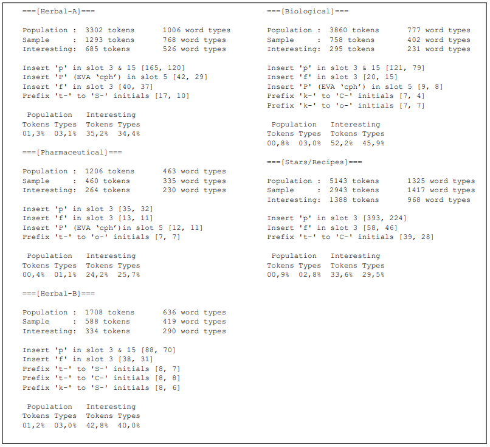
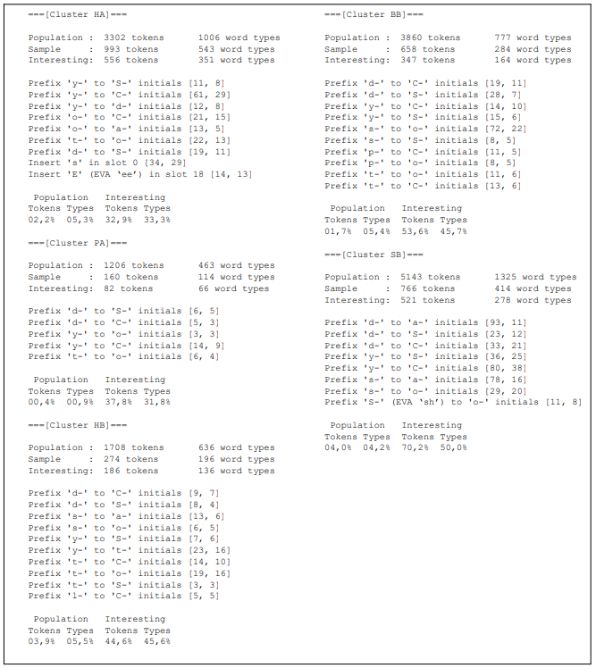
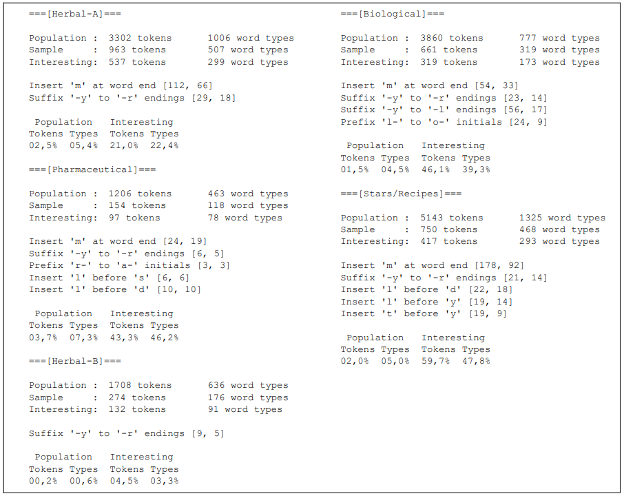

# Note 013 - Transformations

_Last updated Oct. 24th, 2026._

**_This note is part of my article I presented at the International Conference on the Voynich Manuscript 2026._**

_This note refers to [release v.16.0.0](https://github.com/mzattera/v4j/tree/v.16.0.0) of v4j;
**links to classes and files refer to this release**; files might have been changed, deleted or moved in the current master branch.
In addition, some of this note content might have become obsolete in more recent versions of the library._

_Working notes are not providing detailed description of algorithms and classes used; for this, please refer to the 
library code and JavaDoc._

Unless differently stated, this note uses the [Slot alphabet](../alphabet).

_Please refer to the [home page](..) for a set of definitions that might be relevant for this working note._

[**<< Home**](..)

---


## Abstract

In a [previous note](..\012\), I have discussed how morphological patterns we see in Voynich words at special position in the text might be the result of "[interesting words](../012/#interesting)" appearing at those positions.
  
In this note, I try to formally characterizes these patterns through a discrete set of generative transformations.


## Methods and Results

For this note, the [majority version](https://github.com/mzattera/v4j#ivtff) of the Voynich was used;
only the [cluster](../003/) text in running paragraphs (IVTFF locus type = P0 or P1) is considered,
tokens containing unreadable characters were ignored.

As a first step, interesting words for each specific text position were identified, I then try to define how interesting words differ from words in the standard population; these differences are described as transformations applied to otherwise “non-interesting” words. Finally, these transformations are used to explain patterns highlighted in the abstract above.

The following methodology was consistently applied to each textual position[{1}](#Note1):

1. The “sample” is defined as the set of tokens appearing in a specific locus (e.g. all tokens at beginning of a line).
	
1. “Interesting words” are identified as those word types appearing in the sample significantly more often, compared with the standard population (binomial test, p=0.01).
	
1. Potential transformation candidates were hypothesized (e.g. adding 's' as prefix) that, if applied to words in the standard population, could have resulted in an interesting word. Each interesting word was then tested by reversing the transformation (e.g. removing the initial 's-'); if this resulted in a word appearing in the standard population at least three times, the candidate transformation was retained; otherwise, it was discarded.
	
1. Transformation candidates are further filtered, keeping only those such that 1) the transformation can be applied to at least 2% of the interesting tokens, with a minimum of 3. 2) the transformation can be applied to interesting words significantly more often, compared with words in the standard population (binomial test, p=0.01).
	
To illustrate this process, consider the following example: for the Herbal-A section, the analysis begins by isolating all tokens in the first line of each paragraph, which constitutes the sample (n = 1,293 tokens). Within this sample, certain word types appear significantly more often than in the standard population. These statistically significant types are defined as “interesting words” (n = 685 tokens  - point 1. and 2. above)); an example of interesting word could be 'pCor', appearing 7 times in the sample and never in the standard population. The work hypothesis is that interesting words like this were created by adding ‘p’ to an otherwise “non-interesting” word; the transformation candidate is then "insert 'p' at slot 3'. In the case of 'pCor', the word could have been created by adding ‘p’ to the word 'Cor', which appears 6 times in the standard population; the candidate passes the first test (point 3. above).  Finally, we notice that there are several interesting words that could have been generated by this transformation5 (e.g.  'opCy', 'opCol', 'qopCy', 'pCoTy') for a total of 145 tokens and 101 word types; by converse, the standard population has only 12 tokens and 10 word types that could be the result of such transformation (point 4.). Therefore, “insert ‘p’ in slot 3” of existing words is a likely way in which such interesting words in first line of paragraph were created. This does not imply that the author of the Voynich was applying exactly these transformations when writing the
manuscript, but the transformations are a way to describe how interesting words differs from others. In other terms, transformations are descriptive, not prescriptive.

I considered  following six transformations[{2}](#Note2); which possibly cover all changes in words that could cause the regularities described in the introduction (e.g. longer/shorter tokens, anomalous character frequencies, etc.):

  * Inserting a specific character at a given slot.

  * Removing a specific character from a given slot.

  * Substituting a specific character in a given slot with another admissible character for that slot.

  * Inserting a specific character before a given character in a word (at any slot).

  * Adding a one-character prefix to word beginning with a given character.

  * Adding a one-character suffix to word ending with a given character.
  
The results of this analysis for each text position are presented below by section[{3}](#Note3). Although substantial overlap exists, the set of transformations is never completely identical across all sections.
An entry such as:  

```
Insert 'p' in slot 3 [146, 102] 
```

indicates that the specified transformation (inserting 'p' in slot 3) applies to 146 tokens and 102 word types within the subset of identified interesting words.
Summary tables are presented in the following format:

```
 Population   Interesting
Tokens Types  Tokens Types
01,3%  03,1%  35,2%  34,4%
```

For each section, these tables report the proportion of tokens and word types — both in the
standard population and within the set of interesting words—that can be accounted for by the listed
transformations (e.g., in the example above, 35.2% of interesting tokens are explained by at least
one of the listed transformation). These coverage rates are typically an order of magnitude higher
for interesting words than for the standard population. This discrepancy demonstrates that the
transformations do not merely reflect general morphological features of the text, but rather
highlight a distinct pattern unique to interesting words, which in turn accounts for their statistical
deviation from the baseline population (e.g. this specific transformation will account for longer
tokens and a higher frequency of ‘p’).


### First line of paragraphs



Most of the interesting words appear to have ‘p’, ‘P’, or ‘f’ inserted into the appropriate slot
within a word. Notice that ‘t’ and ‘k’ are instead inserted as prefix of words beginning with a very
restricted set of characters (e.g. ‘t’ prefixes words starting with ‘S’ in the Herbal-A section); this
confirms and add details to [existing knowledge](../10/).

The observation that all transformations involve prefixes or insertions explains why tokens in
the first line of each paragraph tend to be longer than other tokens on average.

No justification is provided for other known anomalies (e.g. unusual frequencies of ‘n’).


## First token in a line



Our analysis confirms that interesting words appearing at the beginning of a line have prefixes
such as ‘y’, ‘o’, ‘t’, ‘d’, ‘s’, and ‘l’ and further clarifies in front of what characters those prefixes
appear.

The fact that ‘S’ is a prefix for words starting with ‘o-’ in the Stars/Recipes section
appears as an original finding that probably surfaced only because the analysis has been conducted
for each section separately using the Slot alphabet; the same is true for the fact that interesting
words in Herbal-A section might contain ‘E’.

Again, since all transformation mentioned are prefixes or insertions, it is expected that tokens in
first line of each paragraph are longer on average.

No explanation is provided why ‘k’, ‘C’, ‘S’, ‘a’, and ‘r’ are under-represented.


## Second token in a line

Tokens in second position of a line tend to be shorter than average, but our analysis has found
no transformation that explains why (e.g. removal of characters from specific slots).


## Last token in a line



Beside confirming that the ‘-m’ ending is a characteristic of interesting words at the end of line,
probably an insertion and not a transformation of another character, the analysis also shows how
‘-y’ is frequently appended as suffix to words ending in ‘-l’ or ‘-r’; this could explain why ‘y’
frequency is higher in this position.

More notably, some interesting words in this position can have ‘l’ or ‘t’ inserted before specific
characters; this constitutes a previously undocumented pattern. Notice this goes in the opposite
direction of [other findings](../10/) that show how ‘l’ is less frequent in this position than others.


# Conclusions

In this note I introduce a systematic framework for analyzing localized structural regularities in
the Voynich manuscript. Rather than relying on manuscript-wide statistics, I
isolate "interesting words" that exhibit significantly higher frequency in specific textual positions
and formally characterizes their morphology through a discrete set of generative transformations.

These transformations account for a substantially higher
proportion of tokens among interesting words than in the standard population, confirming that
these rules capture localized structural phenomena rather than generic morphological traits.

While transformations overlap significantly across the manuscript, the specific rule sets vary by
section. This variation provides statistical support for the existence of different “sectional dialect”
in the manuscript.

However, the proposed transformations account only for approximately 40% of interesting
words. While this confirms and refines previously reported anecdotal patterns, it indicates that
additional unidentified constraints govern the remaining population of interesting words, offering
clear avenues for future computational inquiry.

The specificity of these transformations strongly suggests a deterministic or mechanical process
for generating the text. These transformations serve as a formal descriptive model of the text
structural properties rather than a direct reconstruction of the scribe's operational method;
nonetheless, the results indicate that the text—whether meaningful or a hoax—was produced
through systematic procedural steps.


	
---

**Notes**

<a id="Note1">**{1}**</a> Class
[`TransformationExtractor`](https://github.com/mzattera/v4j/blob/v.16.0.0/eclipse/io.github.mzattera.v4j-apps/src/main/java/io/github/mzattera/v4j/applications/transformations/TransformationExtractor.java)
and its subclasses implement this process to identify transformations.

<a id="Note2">**{2}**</a> Package
[`io.github.mzattera.v4j.transformations`](https://github.com/mzattera/v4j/blob/v.16.0.0/eclipse/io.github.mzattera.v4j/src/main/java/io/github/mzattera/v4j/transformations)

<a id="Note3">**{3}**</a> Class
[`Transformations`](https://github.com/mzattera/v4j/blob/v.16.0.0/eclipse/io.github.mzattera.v4j/src/main/java/io/github/mzattera/v4j/transformations/Transformations.java)
contains all transformations we identified, divided by cluster and locus. It also contains method to apply these transformations.

---

[**<< Home**](..)

Copyright Massimiliano Zattera.

<a rel="license" href="http://creativecommons.org/licenses/by-nc-sa/4.0/"></a><br />This work is licensed under a <a rel="license" href="http://creativecommons.org/licenses/by-nc-sa/4.0/">Creative Commons Attribution-NonCommercial-ShareAlike 4.0 International License</a>.
